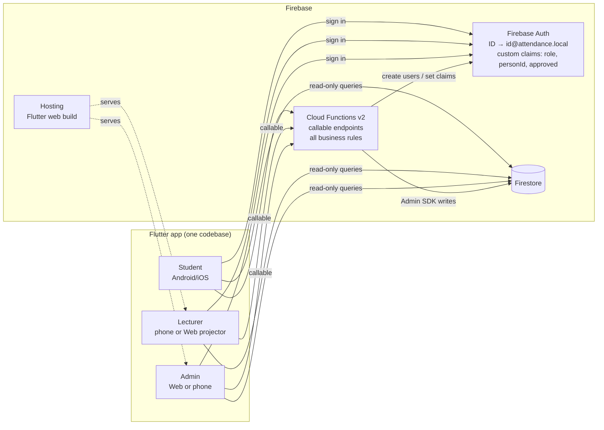
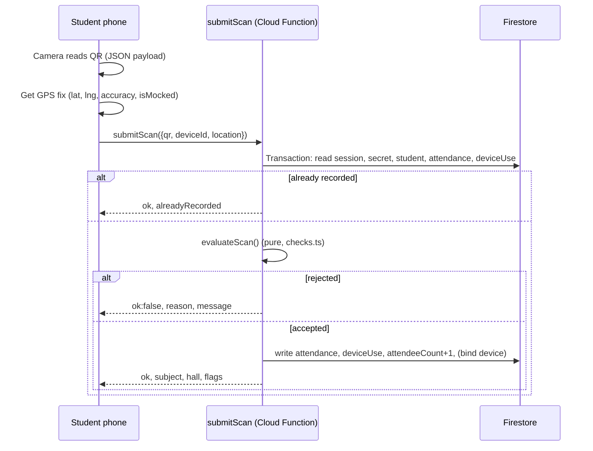
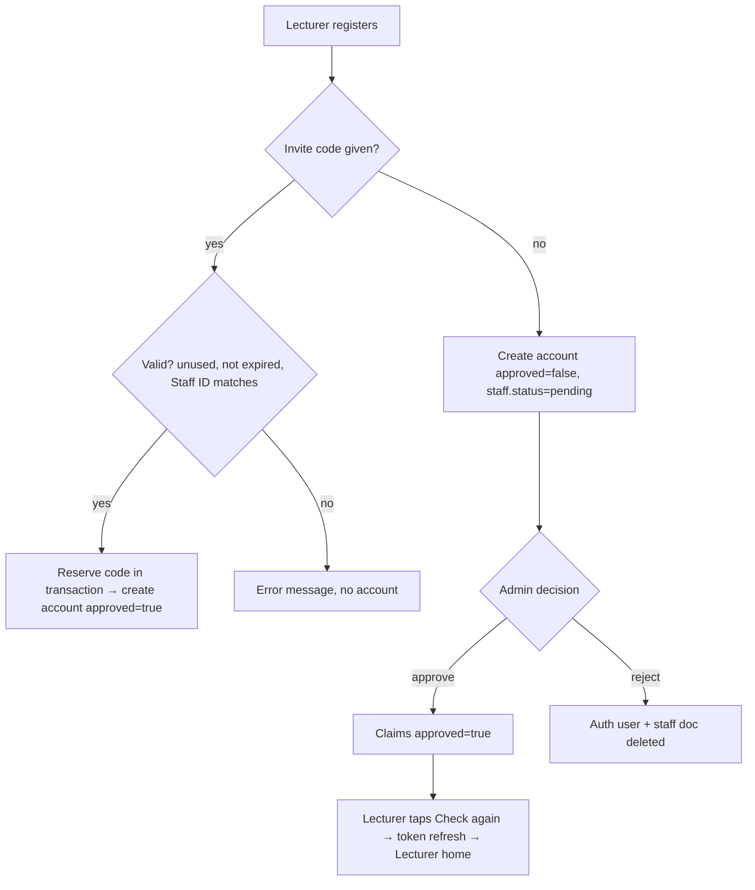

# Architecture

## 1. Overview



**Principle:** clients **read** Firestore (restricted by `firestore.rules`) and **call functions** for every write. Business rules live in pure TypeScript modules so they can be unit-tested without Firebase.

## 2. Tech stack

| Layer | Choice | Notes |
|---|---|---|
| App | Flutter 3.x (Dart ≥ 3.4), Material 3 | Android, iOS, Web from `attendance/app` |
| QR scan | `mobile_scanner` | Camera, QR format only |
| QR render | `qr_flutter` (screen), `pdf` + `printing` (print/PDF) | |
| Location | `geolocator` | Best accuracy, 15 s timeout, `isMocked` |
| Device ID | `flutter_secure_storage` + `uuid` | Random UUID per install, stored in Keychain/Keystore |
| Sharing | `share_plus` | Invite codes and CSV |
| Backend | Firebase Cloud Functions v2 (Node 22, TypeScript strict) | `onCall` callables |
| Database | Cloud Firestore | See [DATA_MODEL](DATA_MODEL.md) |
| Auth | Firebase Auth (email/password) | Email derived from ID |
| Tests | Jest + ts-jest (functions), `flutter test` (app) | |

## 3. Repository layout

```
attendance/
├── CLAUDE.md                 # Instructions for Claude Code
├── README.md                 # Overview + setup
├── docs/                     # PRD and specs (this folder)
├── firebase.json             # Functions, Firestore, Hosting, emulators
├── firestore.rules           # Read-only access per role, no client writes
├── firestore.indexes.json
├── functions/
│   ├── .env.example          # ADMIN_STAFF_IDS
│   ├── src/
│   │   ├── index.ts          # Callable endpoints (thin: load → pure check → write)
│   │   ├── checks.ts         # evaluateScan(): all scan rules, pure
│   │   ├── qr.ts             # QR payload, HMAC signing, slot math, pure
│   │   ├── geo.ts            # Haversine + geofence decision, pure
│   │   └── roster.ts         # Registration/contact validation, invite codes, pure
│   ├── test/checks.test.ts   # Unit tests for all pure modules
│   └── test-rules/           # Firestore rules tests (emulator, npm run test:rules)
└── app/
    ├── pubspec.yaml
    ├── lib/
    │   ├── main.dart                     # Firebase init, AuthGate (routes by role claim)
    │   ├── firebase_options.dart         # Placeholder, replaced by `flutterfire configure`
    │   ├── services/
    │   │   ├── api.dart                  # Wrappers for every callable
    │   │   ├── device.dart               # DeviceId + currentLocation()
    │   │   ├── emulators.dart            # USE_EMULATORS switch, demo project options
    │   │   └── csv_export.dart           # Attendance → CSV → share sheet
    │   └── screens/
    │       ├── login_screen.dart         # Sign in / Register (Student, Lecturer, Admin)
    │       ├── profile_screen.dart       # My details (student + lecturer)
    │       ├── student/                  # student_home, scan_screen
    │       ├── lecturer/                 # lecturer_home, create_session, live_session,
    │       │                             # session_report, attendance_list, pending_approval
    │       └── admin/                    # admin_home, approvals, invites
    ├── android/ ios/ web/                # Platform shells (permissions already added)
    └── test/
```

## 4. Key flows

### 4.1 Scan (the core flow)



### 4.2 Rotating QR on the lecturer screen
1. The live screen calls `getQrToken(sessionId)`. The response holds `qr` and `refreshAtMs` (the next 10 s slot boundary).
2. A timer fires at `refreshAtMs + 200 ms` and calls again. On error it retries every 3 s and shows "Retrying…".
3. Pausing or ending stops the timer. The screen listens to the session doc for its status and live count.

### 4.3 Lecturer acceptance


### 4.4 Phone change
`rebindDevice` sets `boundDeviceId`, `boundAt` and `rebindAt = now`. On a scan with device binding on, if `rebindAt > session.startsAt`, the scan is rejected with `device_changed_during_session`. The initial binding at registration sets `rebindAt = null`, so registering during a class does not block that class.

## 5. Design decisions

| Decision | Why |
|---|---|
| Callable functions for all writes | One place to enforce every rule. Clients can't bypass checks |
| Pure check modules (`checks.ts`, `qr.ts`, `geo.ts`, `roster.ts`) | Fast unit tests, no emulator needed for logic |
| Custom claims for role/approval | Rules and functions read the role from the token without a DB lookup |
| ID → synthetic email | Users know their university ID, not a mailbox. Firebase Auth needs an email |
| Secrets in `sessionSecrets` | Rules deny all client access, so no client can forge QR codes |
| One Flutter codebase incl. web | The projector screen and admin use the same code as the phones |
| No roster | Per product decision: lecturers enter subject/hall per session, and attendance = who scanned |
