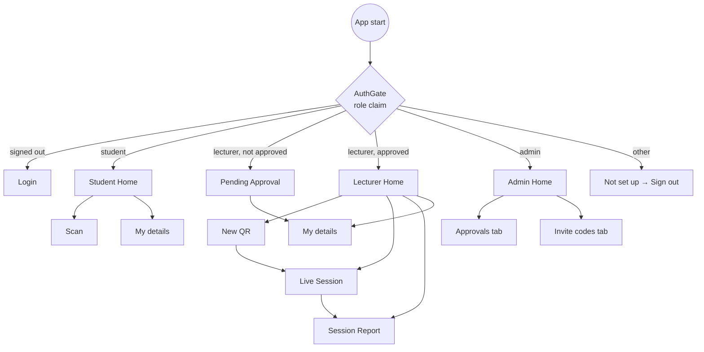

# UI Spec

Material 3, seed colour indigo, light + dark theme. Max form width 400 px (login). Every screen works at 360 px phone width and on desktop web.

## Navigation

`AuthGate` listens to `idTokenChanges()`, so claim changes (approval) re-route automatically after a token refresh.

## Screens

### Login (`screens/login_screen.dart`)
- Segmented: **Sign in | Register**.
- Register → segmented role: **Student | Lecturer | Admin** (no check icon).
- Fields:
  - **Sign in:** ID, Password.
  - **Register Student:** Student ID, Full name, University, Mobile, Email, Password. Hint: "This phone becomes your attendance phone."
  - **Register Lecturer:** Staff ID, Full name, University, Mobile, Email, Password, Invite code (optional, upper-case, with helper text).
  - **Register Admin:** Staff ID, Full name, Password. Hint: "Only Staff IDs on the admin list…"
- Errors appear in red below the fields. The button shows a spinner while busy. After registration the app signs in automatically.

### Student Home (`student/student_home.dart`)
- AppBar: name · My details icon · Sign out.
- Banner (if bound elsewhere): "Your account is set to another phone…" with **Use this phone** (confirm dialog explains the next-class rule).
- "ID: …" and a large **Scan attendance QR** button (72 px tall).
- "My attendance" list (subject, hall · date) with a green check, newest first, max 100.

### Scan (`student/scan_screen.dart`)
States: **scanning** (camera + 260 px frame + hint) → **locating** → **submitting** → **done**.
Done: big ✓ (green) or ✗ (red), title, detail. Buttons: **Done** (success) or **Scan again** (failure).
It ignores QR codes that aren't attendance payloads. A location problem replaces the server message when relevant.

### Profile / My details (`profile_screen.dart`, `student: true|false`)
Read-only ID, then editable Full name, University, Mobile, Email, and **Save**. Load failure → snackbar and close.

### Pending Approval (`lecturer/pending_approval_screen.dart`)
Hourglass, "Waiting for approval", explanation, **Check again** (force token refresh; if the account was deleted → sign out), Edit my details, Sign out.

### Lecturer Home (`lecturer/lecturer_home.dart`)
- AppBar: name · My details · Sign out. Tabs: **Sessions | Attended students**. FAB **New QR**.
- Sessions: icon by mode (autorenew/print), "Subject · Hall", "date · N present · status", LIVE chip or chevron. Tap → Live (open/paused) or Report (ended).

### New QR (`lecturer/create_session_screen.dart`)
Order:
1. Recent chips.
2. Subject.
3. Hall name.
4. **Hall GPS location** card (coords or "Not set", accuracy) + **Use my current location**.
5. Radius slider 20–200 m (step 10).
6. **QR type** segmented Rotating | Static, with explanation text.
7. Anti-cheat switches (geofence locked on for static), time-window slider 5–90 min.
8. **Start & show QR**.

Validation messages: "Enter the subject." / "Enter the hall name." / "Set the hall GPS location…".

### Live Session (`lecturer/live_session_screen.dart`)
- Large "N present", the QR on a white box (sized to the screen's short side − 140, 160–720 px), caption ("Code refreshes every 10 seconds" / "Static code · location check on"), error line when retrying.
- Paused/Ended placeholder instead of the QR.
- AppBar: Attendees · menu (Regenerate, Extend +5 min if the time window is on).
- Bottom: Pause/Resume · Print / PDF (static, open) · **End session** (confirm).

### Session Report (`lecturer/session_report_screen.dart`)
Header "N attended" + flagged count. Rows: green check or orange flag, "Name (ID)", "time · N m from hall", remove button (confirm). AppBar: export CSV.

### Attended Students (`lecturer/attendance_list_screen.dart`)
Date-range button (default last 7 days), search field, CSV button. Rows: "Name (ID)", "Subject · Hall · date time".

### Admin Home (`admin/admin_home.dart`)
AppBar "Admin · name", Sign out. Tabs **Approvals | Invite codes**.
- **Approvals:** row with name (ID), university / 📞 mobile / ✉ email / registered time, ✗ reject (confirm) and ✓ approve. Empty: "No lecturers waiting for approval."
- **Invite codes:** FAB **New code** → dialog (For, Lock to Staff ID) → code dialog (big code, expiry, Copy, Send). List: key / check / timer-off icon, monospace code, "For · Staff ID", status. Active rows: Send, Revoke.

## Copy (key strings)
- Share message: "You are invited to the Class Attendance app as a lecturer. Open the app → Register → Lecturer, … enter invite code: CODE. The code works once and expires on DATE."
- Scan reasons: see `REASON_MESSAGES` in `functions/src/checks.ts`.
